  

  
  
  

<h3 align="center">🔸 Every millisecond counts. 🔸</h3>

---

## 🟧 Biz kimiz?

**İEÜ Racing**, İzmir Ekonomi Üniversitesi'nin Formula Student takımıdır. Öğrenciler olarak tek kişilik bir yarış aracını sıfırdan tasarlıyor, üretiyor ve yarıştırıyoruz.

## 🟧 Araç

| | |
|---|---|
| **Sınıf** | Combustion Vehicle (CV) |
| **Motor** | Yamaha MT-07 (2014), stok MT-07 ECU |
| **Sürüş** | Manuel, pilotlu (otonom sistem yok) |
| **Kural seti** | Formula Student Rules 2027 v1.0 |

## 🟧 Yol haritası 2026-27

- [ ] **PDR**: 30 Ekim 2026
- [ ] **Go / No-Go**: 29 Ocak 2027
- [ ] **Araç lansmanı**: 10 Temmuz 2027

## 🟧 Sponsor olun

Bu aracı mümkün kılan her destek için teşekkür ederiz. Sponsorluk ve iş birliği için bize yazın:

✉️ **ekoracing2025@gmail.com**

---

  <b>İEÜ Racing</b> · Yazılım & Elektronik · İzmir 🔶

